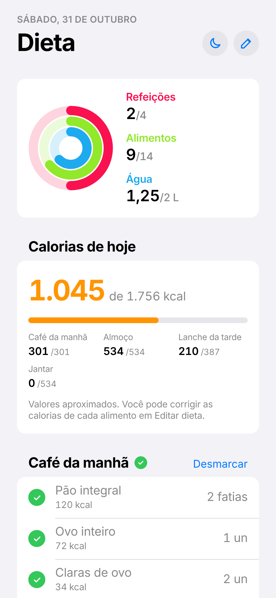
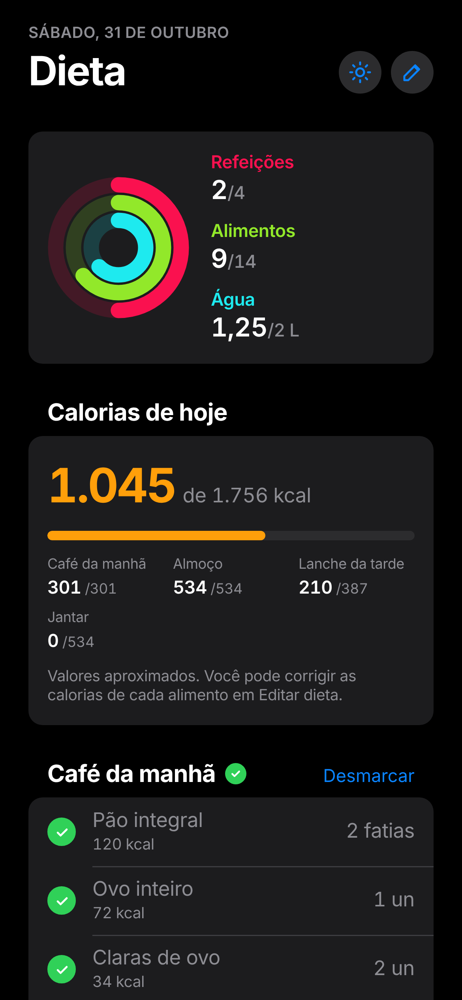
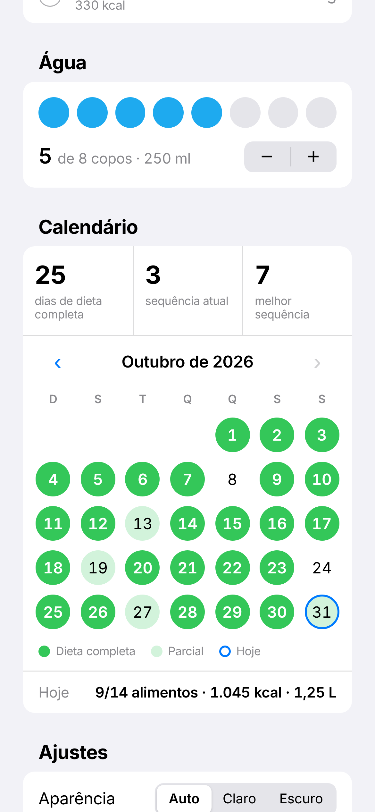
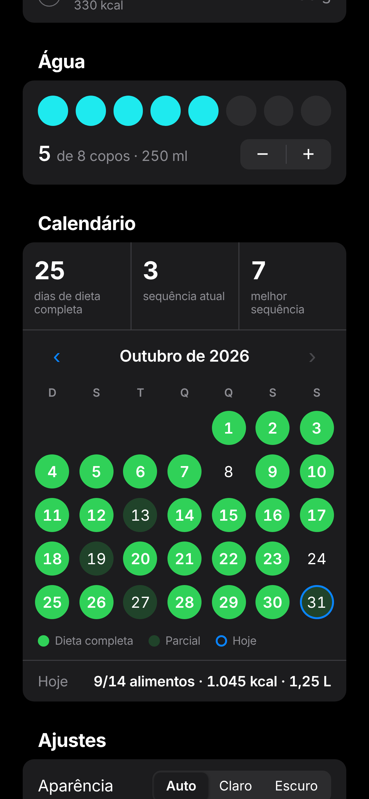
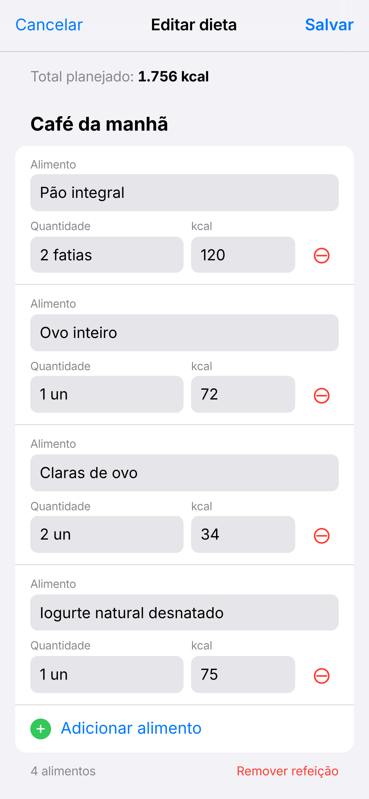
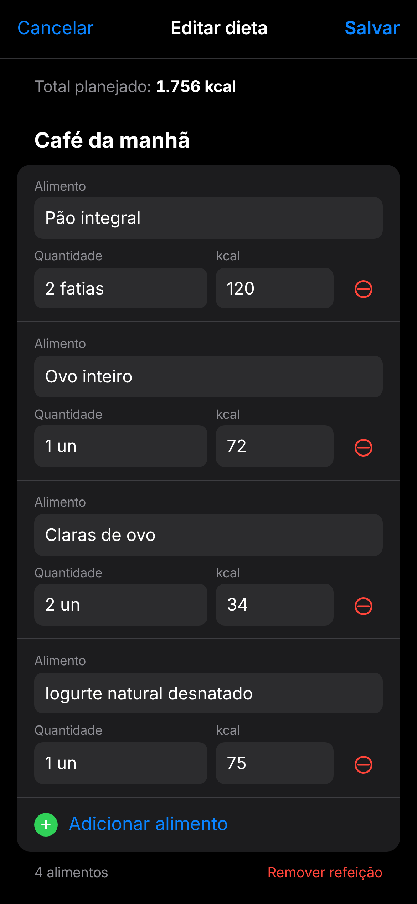

# Dieta Tiago

App de checklist diário da dieta, feito como **PWA** (Progressive Web App): instala no celular com ícone próprio, abre em tela cheia e funciona sem internet.

**Abrir o app:** https://dv-tiagocarvalho.github.io/DietaApp/

## Visual

| | Modo claro | Modo escuro |
|---|:---:|:---:|
| **Início** |  |  |
| **Calendário** |  |  |
| **Editar dieta** |  |  |

## Funcionalidades

- **Checklist por alimento**, com opção de marcar a refeição inteira
- **Anéis de progresso** para refeições, alimentos e água
- **Calorias do dia**: total consumido x planejado e quanto cada refeição somou
- **Controle de água** em copos de 250 ml, com meta ajustável
- **Calendário** com os dias de dieta completa, sequência atual e melhor sequência
- **Dieta personalizável**: adicionar, editar e remover refeições, alimentos, quantidades e kcal
- **Modo claro, escuro ou automático** (segue o tema do celular)
- **Offline-first**: funciona sem internet depois de instalado e atualiza sozinho

## Como instalar no celular (Android)

1. Abra o link acima no **Chrome**
2. Toque em **⋮ → Instalar app**
3. O app aparece na gaveta de apps com o ícone dos anéis

## Tecnologias

- HTML, CSS e JavaScript puro, sem frameworks nem dependências
- Web App Manifest e Service Worker (PWA instalável e offline)
- `localStorage` para salvar o progresso no próprio aparelho
- Hospedado no GitHub Pages

## Privacidade

Não há servidor nem conta. Todos os dados (checks, dieta e histórico) ficam salvos apenas no celular de quem usa.

> As calorias são aproximadas (Tabela TACO e rótulos comuns) e podem ser ajustadas no editor.
